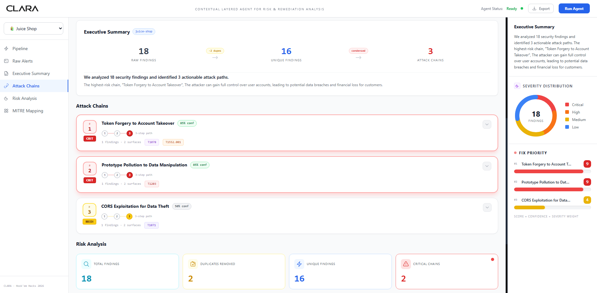
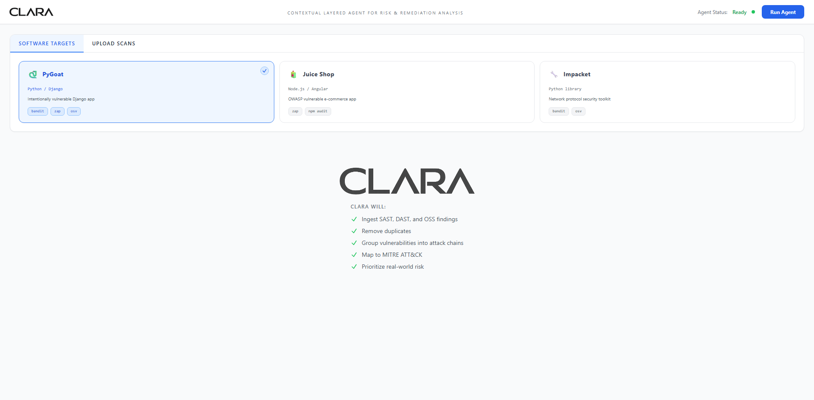
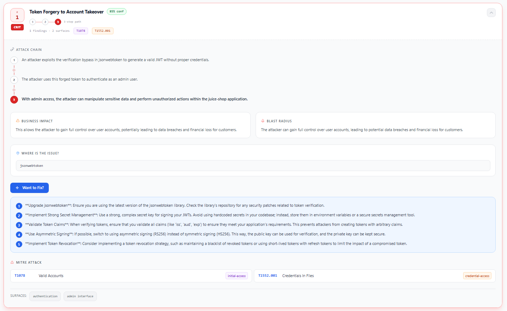
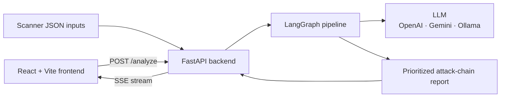
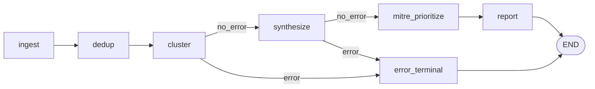

<div align="center">

<br />

<picture>
  <source media="(prefers-color-scheme: dark)" srcset="assets/CLARA_logo_dark.png" />
  
</picture>

<br /><br />

**Contextual Layered Agent for Risk & Remediation Analysis**

Turns noisy scanner output into developer-ready attack chains —
so you fix the three things that matter, not the three hundred that don't.

[](LICENSE)
[](backend/main.py)
[](backend/pipeline/graph.py)
[](frontend/package.json)
[](backend/pipeline/nodes/mitre_prioritize.py)
[](#)

**[Live app](https://claragot.us)** · **[Video walkthrough](https://youtu.be/fpPNLCl3Ljo)** · **[Docs](docs/)**



</div>

---

Security scanners are loud. A single run of Bandit, ZAP and an OSS audit against one app
produces dozens of findings, each scored in isolation, most of them duplicates or noise.
Nobody can tell from that list which *combination* of weaknesses actually lets an
attacker in.

CLARA reads those reports the way an attacker would. It ingests SAST, DAST and OSS
output, deduplicates and clusters the findings by attack surface, then uses an LLM agent
to **chain them into realistic attack paths**, map each step to **MITRE ATT&CK**, and rank
the result by what to fix first — with an AI-generated fix for each chain one click away.

---

## Watch it

<div align="center">

[](https://youtu.be/fpPNLCl3Ljo)

*Full project walkthrough on YouTube*

</div>

> [!NOTE]
> The hosted deployment at [claragot.us](https://claragot.us) runs on about **$5 of total
> API credit**. Light traffic should keep it available, but heavy usage can exhaust it
> sooner than expected. If it's down, the video and screenshots below show everything.

---

## What it does

### Pick a target, run the agent

Choose one of the bundled vulnerable apps — or upload your own scan files — and CLARA
runs the full pipeline against its SAST, DAST and OSS findings, streaming each stage's
progress live.



### Get a ranked report, not a list

The post-scan dashboard leads with an executive summary and the top attack chains,
followed by a risk analysis, severity breakdown, MITRE heatmap and a summary panel.


### Drill into any chain — and ask for the fix

Each attack chain expands into its full kill-chain flow: which findings it uses, how they
connect, the ATT&CK techniques involved, and an **AI fix insight** with concrete
remediation steps.



---

## How it works

### System flow



### Pipeline graph



| Stage              | What it does                                                        |
| ------------------ | ------------------------------------------------------------------- |
| `ingest`           | Parse scanner exports into one normalized finding schema            |
| `dedup`            | Remove repeated findings, keeping the strongest severity signal     |
| `cluster`          | Assign findings to attack surfaces (auth, data, network, …)         |
| `synthesize`       | Build chain narratives that connect exploitable weaknesses          |
| `mitre_prioritize` | Map each step to ATT&CK techniques and rank by fix priority / risk  |
| `report`           | Return the executive summary, stats, findings and attack chains     |

---

## Supported targets

| Target       | Stack                    | Scan types                |
| ------------ | ------------------------ | ------------------------- |
| `pygoat`     | Python / Django          | Bandit + ZAP + OSV        |
| `juice-shop` | Node.js / Angular        | ZAP + npm audit           |
| `impacket`   | Python library           | Bandit + OSV              |
| `custom`     | Your own scan files      | Upload flow in the UI     |

---

## Quick start

**Backend** — Python 3.11+

```bash
cd backend
pip install -r requirements.txt
cp .env.example .env      # then add your LLM key (see below)
uvicorn main:app --reload
```

**Frontend** — Node 18+

```bash
cd frontend
npm install
npm run dev
```

Open `http://localhost:5173`, choose a target (or upload scans), and click **Run Agent**.

On Windows, `start.bat` launches both and `stop.bat` shuts them down.

### Choosing an LLM

CLARA uses OpenAI by default. Set `LLM_PROVIDER` in `backend/.env` to switch:

| `LLM_PROVIDER`     | Required                                           | Model override                        |
| ------------------ | -------------------------------------------------- | ------------------------------------- |
| `openai` (default) | `OPENAI_API_KEY`                                   | `OPENAI_MODEL` (`gpt-4.1-mini`)       |
| `gemini`           | `GEMINI_API_KEY`, or `VERTEX_PROJECT_ID` for Vertex | `GEMINI_MODEL` (`gemini-2.0-flash`)   |
| `ollama`           | A local Ollama server                              | `OLLAMA_MODEL` (`llama3.2`)           |

Setup guides: [Ollama](backend/OLLAMA_SETUP.md) · [Vertex AI](backend/VERTEX_AI_SETUP.md)

---

## API

| Method | Endpoint                    | Purpose                                     |
| ------ | --------------------------- | ------------------------------------------- |
| `GET`  | `/targets`                  | List the bundled targets                    |
| `POST` | `/analyze`                  | Start a run, returns a `run_id`             |
| `GET`  | `/analyze/{run_id}/stream`  | Server-sent events for each pipeline stage  |
| `GET`  | `/analyze/{run_id}/result`  | The final report                            |
| `POST` | `/suggest-fix`              | AI remediation for a single attack chain    |

### Demo mode

The backend can replay cached golden reports instead of calling the LLM. The UI doesn't
expose a toggle, so pass it in the request:

```bash
curl -X POST http://localhost:8000/analyze \
  -H "Content-Type: application/json" \
  -d '{"target":"pygoat","demo":true}'
```

Full details in the [API specification](docs/SPEC_03_API_SPECIFICATION.md).

---

## Deploying

- **Backend** runs `uvicorn main:app --host 0.0.0.0 --port $PORT` — see
  [`backend/railway.json`](backend/railway.json) and [`backend/Procfile`](backend/Procfile).
- **Frontend** points at a remote API through `VITE_API_URL`. It's baked in at build time,
  so redeploy the frontend after changing it.

---

## Documentation

- [Project overview & tech stack](docs/PROJECT_OVERVIEW_TECH_STACK.md)
- [Product requirements](docs/SPEC_01_PRODUCT_REQUIREMENTS.md)
- [Technical architecture](docs/SPEC_02_TECHNICAL_ARCHITECTURE.md)
- [API specification](docs/SPEC_03_API_SPECIFICATION.md)
- [Frontend components](docs/SPEC_04_FRONTEND_COMPONENTS.md)
- [Scan data](data/README.md) — where the bundled scanner reports come from

---

## Honest limitations

- **It reasons about findings, it doesn't verify them.** Attack chains are LLM-synthesized
  from scanner output. They are plausible paths worth investigating, not confirmed
  exploits — treat them as a prioritized starting point.
- **Output quality tracks the model.** Smaller local models via Ollama work, but chains
  are noticeably sharper with hosted models.
- **Runs are kept in memory.** The backend stores runs in a process-local dict, which is
  fine for a single-user demo but resets on restart and won't survive multiple workers.

## Licence

[MIT](LICENSE) © 2026 Troy Davis
